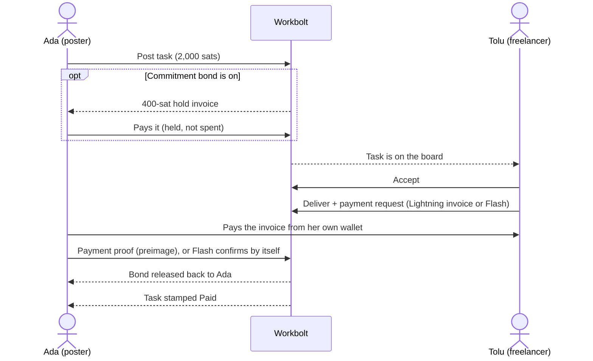

# Workbolt

**Small jobs, paid in sats.** A jobs board where every price is in sats and freelancers are paid wallet to wallet over Bitcoin's Lightning Network, across borders, in seconds.

Built for the **Satoshi Sister Circle Sovereign Stack Hackathon**, Track 4: _Sats for Skills_. Sponsors integrated: **Flash** and **Trezor**.

- **Live app:** https://work-bolt.vercel.app
- **Pitch video:** [add link]
- **Slides:** [add link]

---

## Contents

1. [The problem](#the-problem)
2. [What Workbolt does](#what-workbolt-does)
3. [How a task moves](#how-a-task-moves)
4. [How Bitcoin is used](#how-bitcoin-is-used)
5. [Who can do what](#who-can-do-what)
6. [Architecture](#architecture)
7. [Data model](#data-model)
8. [Project structure](#project-structure)
9. [Run it locally](#run-it-locally)
10. [Test wallets and the demo](#test-wallets-and-the-demo)
11. [Deploy](#deploy)
12. [Notes for contributors and AI agents](#notes-for-contributors-and-ai-agents)
13. [Known limits](#known-limits)
14. [Team and license](#team-and-license)

---

## The problem

A client in Nairobi wants to pay in shillings. The freelancer in Lagos can only receive naira. For a small job, the money that has to cross the border costs more and takes longer than the work itself:

- **Every conversion takes a bite.** Bank fees, exchange spreads and transfer charges eat a big share of a small payment.
- **It's slow.** A one-hour task can take days to clear.
- **Strangers don't trust each other.** Will the poster pay? Is the job even real?
- **Platforms hold the money**, so you end up trusting the platform, not the person.

## What Workbolt does

- **One currency for everyone.** Every task is priced in sats, the same in Lagos and Nairobi, with a naira estimate.
- **Paid in seconds.** The freelancer sends a Lightning invoice; the poster pays it from their own wallet. Workbolt never holds the money and takes no cut.
- **Proof, not promises.** Every Lightning payment has a preimage that proves that exact invoice was paid. Workbolt checks it.
- **Money on the table.** To list a task, the poster can be asked to lock 20% of the price in a Lightning hold invoice (the _commitment bond_). It returns when they pay.
- **Fair by design.** Real sign-in (Google), and the database itself stops a poster from taking their own task.
- **Flash:** freelancers can be paid straight into their Flash wallet; Flash confirms the payment and the task closes by itself.
- **Trezor:** a person can sign a statement with their Trezor to prove a profile is theirs, without sharing keys.

The brief's required features, and where they live:

| Brief                                            | Where                                                                          |
| ------------------------------------------------ | ------------------------------------------------------------------------------ |
| Post a task                                      | `app/tasks/new/page.tsx` → `create_task` database function                     |
| Browse tasks                                     | `app/tasks/page.tsx` (search, filter by skill and status)                      |
| Prices in sats                                   | every ticket (`components/Ticket.tsx`), with a naira estimate                  |
| Status tracking (open / in progress / completed) | ticket status rail and the timeline on `app/tasks/[id]/page.tsx`               |
| Freelancers share Lightning payment requests     | `components/Invoice.tsx` (paste an invoice, use a Lightning address, or Flash) |

## How a task moves



Statuses: `open` → `in_progress` (someone accepted) → `completed` (paid).
A freelancer can give a task back while it is in progress, until they ask to be paid.

## How Bitcoin is used

| What                  | How it works                                                                                                                                                                                                                                                                                                                                                                                              | Code                                                                   |
| --------------------- | --------------------------------------------------------------------------------------------------------------------------------------------------------------------------------------------------------------------------------------------------------------------------------------------------------------------------------------------------------------------------------------------------------- | ---------------------------------------------------------------------- |
| **Payment requests**  | BOLT11 invoices are decoded in the browser; the amount must equal the task price exactly and the invoice must not be expired.                                                                                                                                                                                                                                                                             | `lib/lightning.ts`, `components/Invoice.tsx`                           |
| **Lightning address** | The server asks the freelancer's Lightning address (LNURL-pay) for an invoice of the exact price.                                                                                                                                                                                                                                                                                                         | `lib/server/lnurl.ts`, `app/api/lnurl/route.ts`                        |
| **Paying**            | The poster pays by scanning the QR code with any wallet, or through Bitcoin Connect (Alby extension, Nostr Wallet Connect and others), which returns the preimage automatically.                                                                                                                                                                                                                          | `lib/escrow-client.ts`                                                 |
| **Proof of payment**  | `sha256(preimage) == payment_hash` of the freelancer's invoice. Checked in the browser and, when a bond is involved, on the server.                                                                                                                                                                                                                                                                       | `lib/lightning.ts`                                                     |
| **Commitment bond**   | The server makes a **hold invoice** for 20% of the price (minimum 21 sats) with a payment hash whose preimage only it knows. Paid bonds are held, not spent. The server **cancels** the hold (bond returns to the poster) when the poster proves payment, or **settles** it and forwards the sats to the freelancer if the poster doesn't pay within `ESCROW_CLAIM_AFTER_MINUTES` of the payment request. | `lib/server/escrow-*.ts`, `app/api/escrow/`                            |
| **Flash**             | When the poster is ready to pay, the server asks Flash for a fresh invoice into the freelancer's Flash **USD (cash) wallet** (Flash invoices last 60 seconds), then polls Flash until it reports `PAID` and closes the task.                                                                                                                                                                              | `lib/server/flash.ts`, `app/api/flash/route.ts`, `lib/flash-client.ts` |
| **Trezor**            | Trezor Connect signs a statement that names the profile (`m/84'/0'/0'/0/0`). The server verifies it with `bitcoinjs-message` and saves the badge.                                                                                                                                                                                                                                                         | `lib/trezor.ts`, `app/api/verify-signature/route.ts`                   |

## Who can do what

Rules are enforced in **Postgres**, not in the browser. The browser can only read the board and update its own profile; every task change goes through a `security definer` function that checks `auth.uid()`.

| Action                             | Who                                                            | Enforced by                                               |
| ---------------------------------- | -------------------------------------------------------------- | --------------------------------------------------------- |
| Post a task                        | any signed-in member                                           | `create_task`                                             |
| Accept a task                      | anyone **except the poster**; task must be open and listed     | `accept_task` + table constraint `poster_is_not_assignee` |
| Give a task back                   | the assignee, before asking to be paid                         | `release_task`                                            |
| Ask to be paid (Lightning invoice) | the assignee                                                   | `send_invoice`                                            |
| Ask to be paid (Flash)             | the assignee, using the Flash account on **their own** profile | `request_flash_payment`                                   |
| Mark paid (Lightning, no bond)     | the poster                                                     | `complete_task`                                           |
| Lock / release a bond              | the poster                                                     | `POST /api/escrow/[id]` (`create`, `release`)             |
| Claim an unpaid bond               | the assignee, after the waiting time                           | `POST /api/escrow/[id]` (`claim`)                         |
| Get a Flash invoice                | the poster                                                     | `POST /api/flash` (`invoice`)                             |
| Save a Trezor badge                | the profile owner; statement must name their profile id        | `POST /api/verify-signature` (`save`)                     |
| Edit a profile                     | its owner (name, skills, payout details only)                  | row-level security + column grants                        |

API routes identify the caller from the Supabase access token in the `Authorization: Bearer` header. The `escrows` table (which holds bond preimages) has RLS on and no policies, so only the server's secret key can read it.

## Architecture

```
Browser (Next.js client components)
 ├─ Supabase JS ──────────────► Supabase: Postgres (RLS + task functions), Auth (Google), Realtime
 ├─ /api/escrow  ─┐
 ├─ /api/flash   ─┤  Next.js route handlers on Vercel (verify the caller's token,
 ├─ /api/lnurl   ─┤  then use the Supabase secret key)
 └─ /api/verify-signature ┘
        ├─► Escrow wallet over Nostr Wallet Connect (hold invoices)
        ├─► Flash GraphQL API
        └─► Lightning address servers (LNURL-pay)
Browser-only: Bitcoin Connect (paying), Trezor Connect (signing), CoinGecko (naira estimate)
```

**Stack:** Next.js 16 (App Router, `cacheComponents`), React 19, TypeScript, Tailwind CSS 4, Supabase, `@getalby/sdk` (NWC), `@getalby/bitcoin-connect`, `@trezor/connect-web`, `bitcoinjs-message`, `light-bolt11-decoder`, `qrcode`, `lucide-react`. Hosted on Vercel.

Screens update through Supabase Realtime, and also refresh straight after the browser's own actions, so the app still works if Realtime is slow.

## Data model

All in `supabase/schema.sql`.

| Table      | Purpose                                        | Notes                                                                                                                                                                                                           |
| ---------- | ---------------------------------------------- | --------------------------------------------------------------------------------------------------------------------------------------------------------------------------------------------------------------- |
| `profiles` | One per signed-in person (`id` = auth user id) | Created by a trigger on first sign-in. Holds name, skills, Lightning address, Flash account, Trezor badge, `onboarded`.                                                                                         |
| `tasks`    | The board                                      | Price, deadline, contact, status, poster and assignee, payment request (`invoice`, `invoice_source`, `flash_wallet`), proof (`preimage`), bond mirror (`bond_status`, `bond_sats`, `bond_invoice`), timestamps. |
| `escrows`  | Server-only bond records                       | Payment hash, **preimage**, hold invoice, status, the freelancer's invoice and payout address.                                                                                                                  |

Bond statuses: `none`, `awaiting` (invoice made, not paid), `locked` (held), `returned`, `claimed`, `expired`. A task with a bond is only listed once its bond is `locked`.

## Project structure

```
app/
  layout.tsx                 shell: side rail, header, sign-in provider
  page.tsx                   landing (signed out) or dashboard (signed in)
  tasks/page.tsx             browse
  tasks/[id]/page.tsx        one task: accept, request payment, pay, timeline
  tasks/new/page.tsx         post a task
  work/page.tsx              tasks I'm doing and tasks I posted
  profile/page.tsx           profile, payout details, Trezor, sign out
  terms/ privacy/            legal pages (text in lib/legal.ts)
  not-found.tsx              404
  api/escrow/route.ts        GET: is the bond switched on?
  api/escrow/[id]/route.ts   bond: create, invoice, release, claim
  api/flash/route.ts         Flash: network, check account, invoice, confirm
  api/lnurl/route.ts         Lightning address → invoice
  api/verify-signature/      Trezor: check or save a signature
components/
  Identity.tsx               Google sign-in, session, profile setup dialog
  Invoice.tsx                payment request form, pay screens, proof display
  Bond.tsx                   commitment bond UI
  Ticket.tsx                 task ticket and status rail
  Rail.tsx, Mobileheader.tsx, Mark.tsx, Wordmark.tsx, LegalPage.tsx, Person.tsx, ScrollReset.tsx
lib/
  store.ts                   all reads and task functions (Supabase)
  hooks.ts                   shared live queries, clock, naira rate
  api.ts                     fetch wrapper that sends the access token
  lightning.ts               invoice decoding, proof checks, address checks
  escrow.ts                  bond rules shared by browser and server
  escrow-client.ts           bond and payment helpers for the browser
  flash-client.ts            Flash helpers for the browser
  trezor.ts                  Trezor signing helpers
  types.ts, format.ts, legal.ts, supabase.ts
lib/server/                  server-only (import "server-only")
  supabase-admin.ts          secret-key client, caller check
  escrow-store.ts            escrow records
  escrow-ops.ts              sync with the wallet, release a bond
  escrow-rules.ts            claim timing, public view
  wallet.ts                  NWC escrow wallet
  flash.ts                   Flash GraphQL client
  lnurl.ts                   Lightning address client
supabase/schema.sql          tables, RLS, functions, realtime
```

## Run it locally

**You need:** Node 20+, Yarn, a Supabase project, and a Google Cloud OAuth client.

1. **Install**
   ```bash
   yarn
   cp .env.example .env.local
   ```
2. **Database.** In the Supabase SQL editor, run all of `supabase/schema.sql`. It drops and recreates Workbolt's tables, so only run it on a fresh project or when you're happy to clear the board.
3. **Google sign-in**
   1. Google Cloud → Google Auth Platform: create the consent screen (External), then **Audience → Publish app** so anyone can sign in. Don't upload a logo; that triggers Google verification.
   2. **Clients → Create client → Web application.** JavaScript origins: `http://localhost:3000` and your deployed URL. Redirect URI: the **Callback URL** shown in Supabase → Authentication → Sign In / Providers → Google.
   3. Paste the client ID and secret into that Supabase Google panel and enable it.
   4. Supabase → Authentication → URL Configuration: **Site URL** = your deployed URL; **Redirect URLs** = `http://localhost:3000/**` and `https://<your-app>/**`. Without these, sign-in falls back to the Site URL.
4. **Environment** (`.env.local`):

   | Variable                            | Required | What it is                                                                                                 |
   | ----------------------------------- | -------- | ---------------------------------------------------------------------------------------------------------- |
   | `NEXT_PUBLIC_SUPABASE_URL`          | yes      | Supabase project URL                                                                                       |
   | `NEXT_PUBLIC_SUPABASE_ANON_KEY`     | yes      | Supabase **publishable** key (`sb_publishable_…`)                                                          |
   | `SUPABASE_SECRET_KEY`               | yes      | Supabase **secret** key (`sb_secret_…`). Server only; never prefix with `NEXT_PUBLIC_`.                    |
   | `NEXT_PUBLIC_TREZOR_MANIFEST_EMAIL` | yes      | Contact email Trezor Connect asks apps for                                                                 |
   | `NEXT_PUBLIC_CONTACT_EMAIL`         | no       | Shown on Terms and Privacy; falls back to the Trezor email                                                 |
   | `FLASH_API_URL`                     | no       | Empty = Flash's test API (`https://api.test.flashapp.me/graphql`). Live: `https://api.flashapp.me/graphql` |
   | `WORKBOLT_NWC_URL`                  | no       | NWC connection string for the escrow wallet (must support hold invoices). Empty switches the bond off.     |
   | `ESCROW_CLAIM_AFTER_MINUTES`        | no       | Minutes after a payment request before a freelancer can claim an unpaid bond. Default 60.                  |

5. **Run**
   ```bash
   yarn dev      # http://localhost:3000
   yarn lint
   yarn build    # same type check Vercel runs; do this before pushing
   ```

## Test wallets and the demo

Free test wallets from Alby's faucet come with 10,000 test sats, a Nostr Wallet Connect string and a Lightning address. They can pay each other, hold invoices included. They **cannot** pay real Lightning invoices (including Flash's), and real wallets cannot pay them.

```bash
# create a wallet (prints nostr+walletconnect://...&lud16=<address>)
curl -X POST "https://faucet.nwc.dev?balance=10000"

# check a balance (keep the quotes; the string contains &)
npx -y @getalby/cli@0.10.2 -c "nostr+walletconnect://..." get-balance

# top up (wallet name = the part of the Lightning address before @)
curl -X POST "https://faucet.nwc.dev/wallets/<name>/topup?amount=10000"
```

Use three: **escrow** (its full string goes in `WORKBOLT_NWC_URL`), **poster** (its full string is pasted into _Pay with a connected wallet_, _Nostr Wallet Connect_), **freelancer** (only its Lightning address, in their profile).

**Demo: a 2,000-sat translation task**

1. Ada signs in with Google and posts the task. With the bond on, she locks 400 sats from her connected test wallet; the task shows _Committed_.
2. Tolu joins with another Google account, sets up her profile with her test wallet's Lightning address, and accepts. Ada has no Accept button on her own task, and the database refuses it if she tries.
3. Tolu adds a link to the work and requests payment _From my Lightning address_. Workbolt fetches an invoice for exactly 2,000 sats.
4. Ada pays with her connected wallet. The preimage fills in by itself, the proof is checked, the task is stamped _Paid_, and her bond comes back.

Flash: add a Flash username or **USD wallet ID** to the freelancer's profile, then choose _Get paid in Flash_. Flash's test API runs on mainnet, so its invoices need a real wallet with real sats to pay.

## Deploy

Vercel, with the same environment variables. Set them **before** pushing, because they're read at build time. Add the deployed URL to Supabase's Site URL and Redirect URLs, and to the Google client's JavaScript origins.

## Notes for contributors and AI agents

- **Next.js 16 with breaking changes.** Read `AGENTS.md` and the guides in `node_modules/next/dist/docs/` before changing framework code. `cacheComponents` is on: read dates and the URL only in client effects or behind `<Suspense>`, and call `await connection()` in route handlers that read env at request time.
- **No `src/` folder.** `@/*` maps to the repo root.
- **Never trust the browser with rules.** New task actions go into `supabase/schema.sql` as `security definer` functions that check `auth.uid()`, and are granted to `authenticated` only. Don't grant table `insert`/`update` on `tasks` to browser roles.
- **Server secrets stay in `lib/server/`.** Those files start with `import "server-only"`. The Supabase secret key and the escrow wallet string must never reach client code.
- **API routes must check the caller** with `requireCaller(req, allowedUserId)` from `lib/server/supabase-admin.ts`.
- **Styling:** Tailwind utility classes only (no new CSS files or inline style objects), `lucide-react` for icons, mobile first. Design tokens (`plum`, `gold`, `paper`, `mist`, `ink-soft`, `teal`) and shared classes (`btn-primary`, `btn-ghost`, `btn-gold`, `field`, `shadow-ticket`, `perf`) live in `app/globals.css`.
- **Copy:** plain, direct sentences; no em dashes.
- **Before pushing:** `yarn lint` and `yarn build`.

## Known limits

- One Google account per person is enforced; one _human_ per account isn't. Someone could make a second Google account to accept their own task. The commitment bond makes that pointless, because faking a job still locks real money.
- There's no dispute or "request changes" step. Poster and freelancer sort that out through the task's contact details.
- Flash invoices go into Flash **USD (cash)** wallets only, last 60 seconds, and Flash has no hold invoices, so the bond always uses the NWC escrow wallet.
- The naira estimate comes from CoinGecko in the browser and is only an estimate.
- Some test wallets are slow to answer bond checks before a bond is paid; the server gives up after 12 seconds and checks again.

## Team and license

Built by **Oluwakemi Atoyebi** and **Ifeoluwa Sanni** for the Satoshi Sister Circle Sovereign Stack Hackathon.

All rights reserved. The source is shared for review; it isn't licensed for reuse. Open-source dependencies keep their own licenses (MIT, ISC and the SIL Open Font License).
